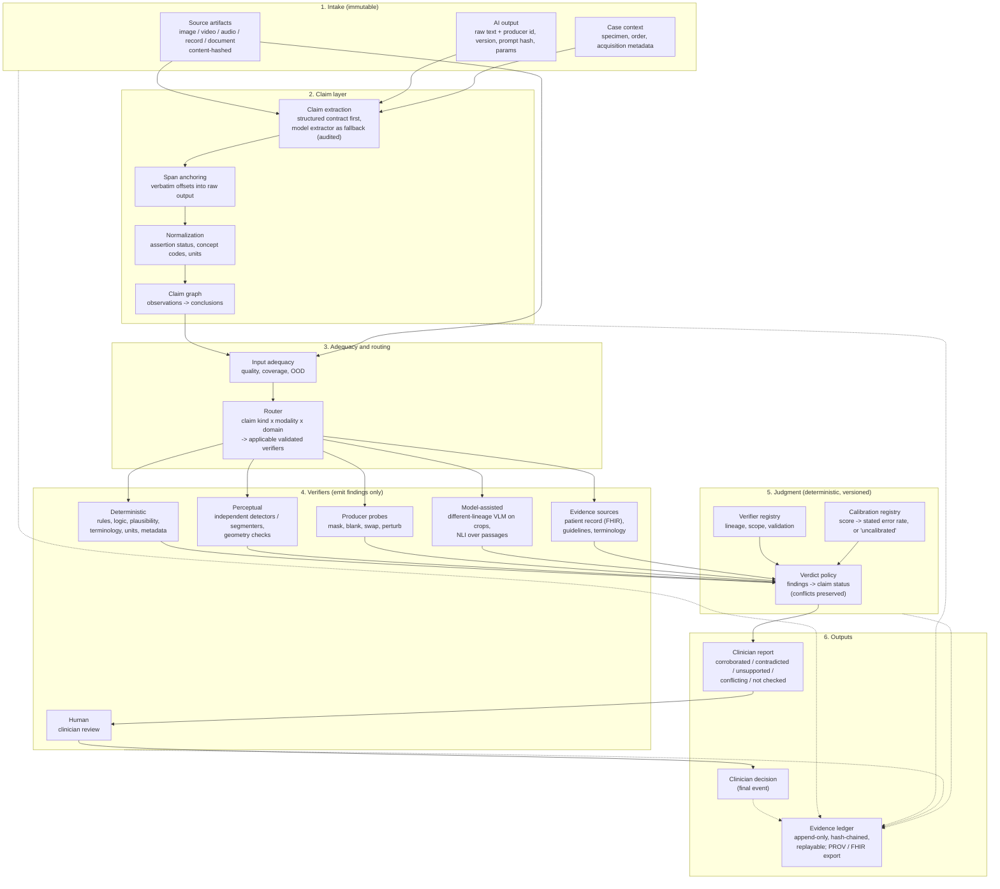
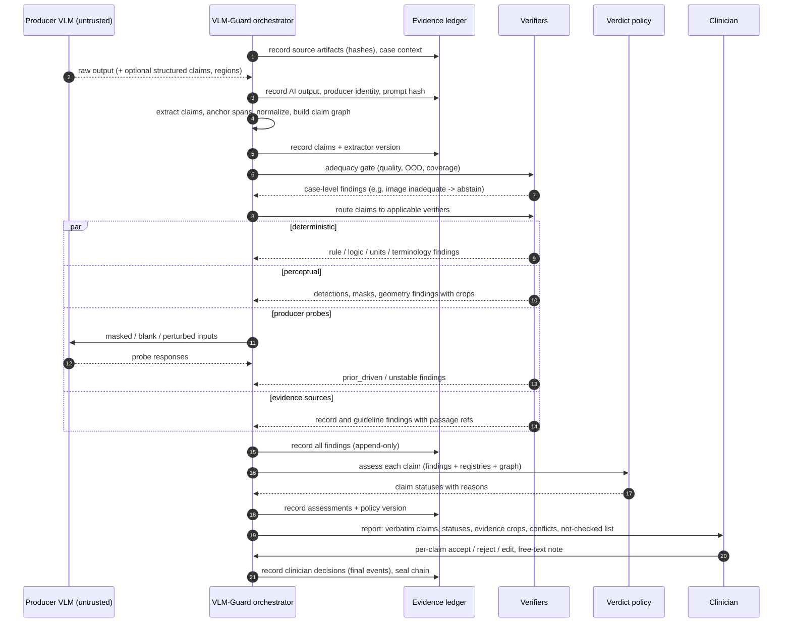

# VLM-Guard: Architecture Assessment and Evolution Plan

## From a rule-based guardrail to a hybrid, evidence-centred clinical AI verification and audit layer

Status: proposal for discussion. Date: 2026-10-31. Covers repository state at v0.2.0 (commit `20f8bbc`).

---

## Contents

0. [Executive summary](#0-executive-summary)
1. [The problem, restated](#1-the-problem-restated)
2. [Assessment of the current implementation](#2-assessment-of-the-current-implementation)
3. [Literature and technology review](#3-literature-and-technology-review)
4. [The central technical problem: verifying visual claims](#4-the-central-technical-problem-verifying-visual-claims)
5. [Proposed target architecture](#5-proposed-target-architecture)
6. [Verification workflow: from AI output to clinician review](#6-verification-workflow-from-ai-output-to-clinician-review)
7. [Trust model and enforcement mechanisms](#7-trust-model-and-enforcement-mechanisms)
8. [Gap analysis: current vs target](#8-gap-analysis-current-vs-target)
9. [Phased roadmap](#9-phased-roadmap)
10. [Evaluation and benchmarking strategy](#10-evaluation-and-benchmarking-strategy)
11. [Recommended libraries, models, datasets and integrations](#11-recommended-libraries-models-datasets-and-integrations)
12. [Decisions to make before writing more code](#12-decisions-to-make-before-writing-more-code)
13. [References](#13-references)

---

## 0. Executive summary

**What VLM-Guard should become.** An independent layer that turns an AI-generated medical output into a set of explicit, individually checkable claims. It collects evidence for and against each claim from several mechanisms that fail in different ways, and gives the clinician a traceable account of what was checked, what was found, what could not be checked, and where the evidence conflicts. It should never be the thing that decides the diagnosis, and it should never rewrite the AI's output.

**The core architectural idea.** Separate *producing evidence* from *judging claims*, and keep judgment out of models:

- **Verifiers** (rules, vision models, record lookups, knowledge retrieval, producer probes, humans) only emit **findings**: "supports", "contradicts", "insufficient evidence" or "not applicable", each with pointers back to the source evidence (an image region, a record field, a guideline passage).
- A **deterministic, versioned verdict policy** (code, not a model) turns those findings into a claim status. It follows explicit, asymmetric rules: for example, a model alone can never establish corroboration without localized evidence, two models from the same family count once, any contradiction blocks corroboration, and the producing model never vouches for itself.
- Every step is written to an **append-only, hash-chained evidence ledger** that can be replayed and exported (W3C PROV, FHIR Provenance/AuditEvent).
- The **clinician report** shows each original claim verbatim, its status, the evidence behind it, conflicts side by side, and an explicit "not checked" category. The clinician's decision is recorded as the final event.

**Why this works without replacing trust in one model with trust in another.** Different mechanisms verify different parts of a claim:

- **Perception (is it in the image?)**: independent specialist detectors or segmenters, with localized and inspectable evidence.
- **Inference (does the diagnosis follow from the observations?)**: deterministic rules.
- **Context (is it consistent with this patient?)**: structured record checks.
- **Knowledge (is it consistent with accepted medicine?)**: versioned guideline and terminology sources.
- **Producer behaviour (did the model actually look?)**: black-box probes such as masking the region or swapping in a blank image.

Each produces evidence the clinician can inspect. None is treated as ground truth, and the policy is designed so that correlated model errors cannot silently upgrade a claim.

**What the current code means for this.** The existing engine is small (about 1,500 lines of core plus plugins), well typed with Pydantic, and has useful seeds: claim-level `Analysis`, cross-claim rules, an audit trail, and plugin packs. It also has a design flaw that conflicts with the goal: **rules rewrite the AI output** (relabel, "promote" a diagnosis, overwrite evidence text). The verifier therefore acts as a second diagnostician whose own output is then reported as validated. I also found verified correctness bugs where a blocked claim ends up reported as `passed`, and where a correct guideline claim is wrongly blocked and rewritten (Section 2.3). An **incremental evolution is feasible**: a full rewrite is not justified. But the data model and the engine semantics need to change before more rules or modalities are added.

**Recommended first target.** One visual use case with public localized ground truth, measured end to end, before any breadth. Malaria thin blood smears fit the existing NTD work and have public bounding-box data. Chest X-ray is the alternative with the richest grounding benchmarks. Success is defined by claim-level metrics, especially the precision of "corroborated" (how often a claim marked corroborated is actually true), not by how many rules or modalities are supported.

---

## 1. The problem, restated

A clinician receives an AI output (text about an image, a report draft, a summary of an encounter) and must decide what to rely on. Three facts frame the design:

1. **The generator is not an authority on its own correctness.** Its stated confidence, its explanation and its attention maps are outputs of the same system, not independent evidence. Saliency methods have been shown to localize pathology substantially worse than human experts, and some fail basic randomization sanity checks ([Saporta et al., 2022](https://research.regionh.dk/en/publications/benchmarking-saliency-methods-for-chest-x-ray-interpretation/); [Arun et al., 2021](https://arxiv.org/pdf/2008.02766)).
2. **A second model does not solve the trust problem.** Across more than 350 LLMs, models agree on the same wrong answer far more often than chance, and larger, more accurate models are *more* correlated in their errors, even across providers ([Kim et al., ICML 2025](https://arxiv.org/html/2506.07962v1)). Agreement between two models is weak evidence of correctness, not proof.
3. **Showing explanations to clinicians does not reliably protect them.** In a randomized vignette study of 457 clinicians, a systematically biased model reduced diagnostic accuracy by roughly 9 to 11 points, and heatmap explanations did not significantly mitigate this ([Jabbour et al., JAMA 2023](https://ihpi.umich.edu/news-events/news/clinicians-could-be-fooled-biased-ai-despite-explanations)). A verification layer that shows a reassuring green badge can *increase* automation bias.

The design goal follows: **produce independent, inspectable evidence at claim level, make the limits of that evidence explicit, keep conflicts visible, and leave the decision with the clinician.** "Verified" in this system should mean "corroborated by independent evidence the clinician can inspect", never "true".

---

## 2. Assessment of the current implementation

### 2.1 What exists

| Area | Files | What it does |
|---|---|---|
| Data model | `vlm_guard/core/analysis.py` | A single Pydantic `Analysis` per claim: label, domain, claim type, verbatim claim text, categorical confidence, evidence, findings, recommendation, free-form metadata, `validation_status`. |
| Rules | `vlm_guard/core/rule.py` | `BaseRule.condition/action` and `CrossClaimRule` over all claims plus answer. Actions: pass, block, correct, promote, flag. |
| Engine | `vlm_guard/core/engine.py` | Runs rules in registration order, each on the output of the previous one; records audit entries; applies cross-claim rules sorted by `order`. |
| Audit | `vlm_guard/core/audit.py` | In-memory list of entries with before/after snapshots, message, severity, claim index. |
| Pipelines | `core/pipeline.py`, `core/text_pipeline.py` | Image: optional enhancement, call model, parse, apply rules. Text: parse claims, apply rules, optionally send a correction prompt back to the model and retry once. |
| Parsing | `llm/parsing.py`, `llm/claim_parser.py` | Regex and JSON extraction into `Analysis`; keyword-based label and claim-type inference. |
| Image | `image/enhance.py`, `image/quality.py` | PIL enhancement strategies; blur, exposure and grayscale heuristics. |
| Packs | `vlm_guard/plugins/ntd_microscopy`, `plugins/heartsafe` | NTD microscopy rules, prompts, PDF report; cardiology COR and LVEF rules plus an answer-consistency rule. |
| Tests | `tests/` | 71 tests, all passing. |

Dependencies are light (`pydantic`, `Pillow`), with heavy ML in optional extras. That is the right instinct and should be kept.

### 2.2 What is sound and worth keeping

- **Claim-level granularity.** `Analysis.claim_text`, `claim_type`, and `parse_reasoning_steps()` already move away from judging a whole answer. This is the right unit.
- **Cross-claim checks.** `CrossClaimRule` is the seed of a claim-graph consistency checker.
- **Audit as a first-class output.** Before/after snapshots, severity and claim index are the right instincts. The UI-friendly `to_dict()` shows the intent to expose this to users.
- **Pack-based domain knowledge.** Keeping domain content in packs, separate from the engine, is correct.
- **Image quality gate.** `check_image_quality` is the seed of an input-adequacy gate, which the target architecture needs before any perceptual verification.
- **Light core with optional heavy extras.**

### 2.3 Problems, in order of architectural significance

**A. The verifier rewrites the output it is supposed to verify.** Rules mutate `label`, `confidence`, `evidence`, `recommendation` and `metadata` in place:

- `SampleTypeImpossibilityRule` relabels Malaria to Leishmaniasis and replaces the evidence text with "Amastigotes identified within bone marrow macrophages."
- `UnclearPromotionRule` turns "Unclear" into Trypanosomiasis, Filariasis or Schistosomiasis based on keywords in the model's own description.
- `CORLevelRule` overwrites the claim's label with the guideline value.

The result is that the final output mixes model claims with rule-generated claims. The clinician sees a diagnosis the model never made, with evidence text the rule wrote, marked as validated. That violates every principle in the brief. It also means a "promotion" trusts the model's free-text perception completely, which is exactly the trust problem we want to avoid. **This is the most important thing to change.**

**B. Verified status-overwrite bug.** In `GuardrailEngine.apply`, when a later rule's condition matches but it takes no action, the claim's `validation_status` is set to `"passed"` unconditionally, overwriting an earlier `"blocked"`. Reproduced with HeartSafe rules: a claim "MRA is Class 2a in HFrEF ..." is blocked by `CORLevelRule`, its label rewritten to "Class 1", then `LVEFThresholdRule` matches and sets status to `passed`. The final object reads `label="Class 1", validation_status="passed"`: **a wrong model claim is turned into a "validated" correct one.**

**C. Verified false block from text matching.** `CORLevelRule` searches for `"class i"` before `"class iia"`, so "Ivabradine is Class IIa ..." (correct per the rule's own table) is parsed as Class I, blocked, and its label rewritten. Combined with bug B the final status is `passed` with a `validation_message` that says it was blocked. Substring matching without negation also makes NTD helpers treat "no flagellated organisms seen" as evidence for trypanosomes (reported earlier as a separate task).

**D. The audit is not a reliable record.**
- `TextGuardPipeline` replaces the first attempt's audit with the retry's. Because `apply_to_claims` clears and reuses the same `engine.audit` object, the first attempt's findings are lost entirely.
- `apply()` does not clear the audit, while `apply_with_audit()` does: two call paths with different semantics.
- The audit lives on the engine instance, so the engine is not safe for concurrent or re-entrant use.
- `to_dict()` drops before/after snapshots, context and timestamps.
- Nothing records the input image hash, the model identity or version, the prompt, the rule or pack version, or whether the image was enhanced before the model saw it. A given result cannot be reproduced or traced to its inputs.

**E. Status is derived from the model's self-reported confidence.** `VLMGuardPipeline` sets `status="ok"` unless `confidence == "Low"`. The model's own confidence is treated as the release criterion.

**F. The retry loop optimizes the generator to pass the checks.** Feeding rule messages back to the model teaches it to produce text that satisfies the rules, not text that is more correct (a Goodhart effect). This is a legitimate generation-side technique, but it does not belong inside an independent verification layer, and every attempt must be recorded if it is used.

**G. Parsing fragility.** `parse_to_analysis` uses a non-greedy regex that stops at the first `}`, so any output with nested JSON (for example a `metadata` object, as in the README) fails to parse and silently becomes `Unclear/Low` (reproduced). The generic `claim_parser` contains cardiology keywords and defaults unknown claim types to `"diagnosis"`.

**H. Coupling and packaging.**
- `vlm_guard/__init__.py` imports the NTD plugin, so the core depends on a domain pack.
- `plugins/heartsafe` is installed as a top-level package named `plugins`, which can collide with other packages.
- `pipeline.py` mutates the caller's `context` dict (reproduced).
- The NTD report module imports `fpdf` at module import time.

**I. Enhancement before inference without provenance.** The model sees an enhanced image, the rules never see pixels, and nothing records which image the claims refer to. Any future grounding check must run on the original pixels and record any derived images as separate, hashed artifacts.

### 2.4 Verdict on the codebase

The current engine is a **rule-based output rewriter with an audit log**, not yet a verifier. The code is small and clean enough that restructuring is cheap, and the main concepts map onto the target architecture (Section 8). **Evolve incrementally; do not rewrite.** But change the semantics first (no mutation, findings instead of actions, policy-derived status) before adding verifiers, because every new verifier built on the current semantics would inherit the problems above.

---

## 3. Literature and technology review

Evidence grading used below:

- **Validated**: peer-reviewed with independent replication, or a regulated or widely deployed product.
- **Research prototype**: published method with benchmark results, usually single-group, often preprint.
- **Component**: maintained software usable today, with known validation status.

Many relevant medical VLM verification papers are 2025 to 2026 preprints. In several cases I could read only abstracts and summaries, noted as such. Treat specific numbers as indicative until reproduced.

### 3.1 Hallucination benchmarks for medical VLMs

| Work | What it measures | Relevance to VLM-Guard | Grade |
|---|---|---|---|
| **HEAL-MedVQA** ("Localizing Before Answering", IJCAI 2025) ([paper](https://ijcai.org/proceedings/2025/0853.pdf), [dataset](https://huggingface.co/datasets/MM-Hallu/HEAL-MedVQA)) | 67K chest X-ray QA pairs with doctor-annotated segmentation masks; protocols that test robustness to textual and visual shortcuts. Finds models answer from linguistic patterns or attend to irrelevant regions. Proposes LobA (localize, then answer). | Gold-standard spatial evidence for testing a grounding verifier; the LobA idea supports requiring localization as part of a claim. | Peer-reviewed benchmark; method is a research prototype |
| **Med-StepBench** ([arXiv 2605.10002](https://arxiv.org/abs/2605.10002)) | Step-wise hallucination in 3D PET/CT reasoning across four stages: anatomical mapping, lesion identification, feature characterization, diagnostic synthesis. Each step labelled true or hallucinated. Reports systematic failures hidden by aggregate metrics. | Directly supports a **claim graph** with leaf observations and dependent conclusions, and per-step evaluation. Image counts differ between versions; check before use. | Preprint benchmark |
| **MedVH**, **MedHEval**, **MedHallTune** ([MedVH](https://www.ncbi.nlm.nih.gov/pmc/articles/PMC12363988/), [MedHEval](https://arxiv.org/pdf/2503.02157), [MedHallTune](https://arxiv.org/pdf/2502.20780)) | Hallucination taxonomies and benchmarks. MedVH reports medically fine-tuned models can hallucinate *more* than general models. MedHEval separates visual misinterpretation from knowledge deficiency. | Taxonomy for claim types and failure modes; benchmark sources. | Benchmarks |
| **Counterfactual grounding** ([arXiv 2607.03647](https://arxiv.org/pdf/2607.03647)) | Tests with blank, shuffled, absent and hard-negative images. Swapping the image costs medical benchmarks only about 6.5 points versus 48 to 61 points in general domains. | Strong evidence that medical VLMs often do not use the image. Justifies **producer probes** as a standard verifier. | Preprint |
| **Gut-VLM** ([arXiv 2505.07001](https://arxiv.org/pdf/2505.07001)) | Only about 30% of VLM responses fully correct on GI images; sentence-level expert hallucination labels. | Example of sentence-level expert annotation protocol. | Benchmark |
| **MedHallu** ([arXiv 2502.14302](https://arxiv.org/abs/2502.14302)) | Text-only. Best detector F1 0.625 on hard hallucinations; adding a "not sure" option improves F1 by up to 38%. | Evidence that **abstention as a first-class outcome** improves detection quality. | Peer-reviewed (EMNLP 2025) |

### 3.2 Detection and verification methods for medical VLM outputs

| Method | Mechanism | Independent of producer? | Grade and caveats |
|---|---|---|---|
| **CoEV**, Counter-Evidence Verification ([arXiv 2606.18609](https://arxiv.org/abs/2606.18609), MICCAI 2026, [code](https://github.com/Zhounan1222/CoEV)) | Maps each statement to image regions, checks in both directions, places claims on a factuality-grounding quadrant map. Masks the claimed region and re-queries: a claim that survives masking is likely prior-driven. Reports +3.0 PR-AUC and +3.9 ROC-AUC on average for detection, and over 11.9% fewer hallucinations in report generation when used for correction. | Partly. Region masking is a producer probe; correction asks the VLM to rewrite. | Research prototype with code (not inspected). **Adopt the detection probe, not the rewrite step.** |
| **V-Loop** ([arXiv 2601.18240](https://arxiv.org/abs/2601.18240)) | Forms a verification question from the answer and re-queries the image ("logical loop"); flags when the loop fails; checks attention consistency. | No (same model), and relies partly on attention. | Prototype. Useful as a weak producer-consistency signal only. |
| **PROVE** ([arXiv 2609.29604](https://arxiv.org/pdf/2609.29604)) | Black-box detector that routes questions into three verification regimes and applies regime-specific operators with an adaptive calibration layer. Reports 0.821 AUROC, +0.159 over the best black-box baseline, including two unseen benchmarks. | Black-box over the producer. | Prototype; only conclusion read. The **routing idea** (different claim types need different verifiers) matches this proposal. |
| **VASE, VIHD, UniVRSE** ([VASE](https://papers.miccai.org/miccai-2025/1005-Paper0083.html), [UniVRSE](https://arxiv.org/pdf/2503.20504)) | Semantic-entropy variants conditioned on visual perturbation: if an answer does not change when the image is degraded, it is probably language-prior driven. | No (sampling the producer). | Prototypes. Uncertainty signals, not correctness evidence. |
| **CEBaG** ([arXiv 2603.21693](https://arxiv.org/pdf/2603.21693)) | Deterministic detector for short-form medical VQA using confidence-evidence gain, no repeated sampling. | Uses producer internals. | Prototype |
| **Formal verification of report logic** ([arXiv 2602.24111](https://arxiv.org/abs/2602.24111)) | Autoformalizes findings and impression into SMT constraints and checks satisfiability against a clinical knowledge base with Z3. Explicitly guarantees internal consistency, **not** agreement with the image. | Yes, for the logic part. | Prototype. Strong model for the deterministic **inference-edge** layer. |
| **ConfLVLM** ([EMNLP 2025](https://papers.cool/venue/2025.emnlp-main.576@ACL)), **conformal factuality** ([Cherian et al.](https://web3.arxiv.org/pdf/2406.09714v2)), **MACI** ([ICLR 2026](https://arxiv.org/abs/2602.01285v1)) | Treat each generated detail as a hypothesis and filter with conformal guarantees. ConfLVLM evaluates on radiology report generation. | Depends on the scoring function. | Peer-reviewed methods. Guarantees hold only under exchangeability with the calibration set. **Best available basis for calibrated abstention.** |
| **Semantic entropy** ([Farquhar et al., Nature 2024](https://pmc.ncbi.nlm.nih.gov/articles/PMC11186750)) | Clusters sampled answers by meaning; high entropy signals confabulation. Authors state it does not catch consistent, confidently wrong errors. | No. | Validated for its scope. Useful as an "unstable" flag only. |
| **Saliency and attention as evidence** ([Saporta 2022](https://research.regionh.dk/en/publications/benchmarking-saliency-methods-for-chest-x-ray-interpretation/), [Arun 2021](https://arxiv.org/pdf/2008.02766)) | All tested methods significantly worse than human localization; several fail model-randomization tests. | Not applicable. | **Validated negative result: do not treat as evidence.** |

### 3.3 Grounded generation and grounding evaluation

| Work | Relevance | Grade |
|---|---|---|
| **MAIRA-2** and **RadFact** ([arXiv 2406.04449](https://arxiv.org/html/2406.04449v1), [RadFact code](https://github.com/microsoft/RadFact)) | Grounded report generation where each finding carries boxes. RadFact scores sentence factuality and spatial correctness (a box counts if at least 50% overlaps the reference). Reported spatial precision and recall around 32 to 34% (secondary source), showing that **localization is the weakest link even in purpose-built models**. | Peer-reviewed; RadFact is a usable component. |
| **GREEN, RaTEScore, RadGraph F1** ([GREEN](https://arxiv.org/pdf/2405.03595), [RaTEScore](https://arxiv.org/pdf/2406.16845), [RadEval](https://preview.aclanthology.org/credits/2025.emnlp-demos.40)) | Report-level factuality metrics against a reference report. GREEN shows the strongest agreement with radiologist error counts in several studies; rankings vary by dataset. These are **evaluation metrics needing a reference**, not runtime verifiers. | Components for the benchmark harness. |
| **ReXTrust** ([arXiv 2412.15264](https://arxiv.org/pdf/2412.15264)) | Fine-grained hallucination detection in radiology reports using model internals. | Prototype |

### 3.4 Independent perception components

| Component | Use | Grade |
|---|---|---|
| **Task-specific detectors** (for example YOLO, Faster R-CNN, RetinaNet trained on public malaria thin-smear boxes) ([NIH thin-smear COCO re-annotation](https://arxiv.org/html/2507.18483v1), [MP-IDB study](https://doaj.org/article/47dc0653d5964f1d881f3708e33a25e6)) | Closest thing to an independent "second reader" for object-level claims. Must be trained and validated by us, on data split away from the benchmark. | Mature technique; per-task validation required. |
| **Regulated malaria microscopy products** (for example Noul miLab) ([preprint](https://www.medrxiv.org/content/10.1101/2025.06.11.25329408.full.pdf)) | Proof that automated parasite detection is deployable; possible future integration as an external verifier. Regulatory status varies by country. | Product |
| **BiomedParse** ([Microsoft Research](https://microsoft.com/en-us/research/blog/biomedparse-a-foundation-model-for-smarter-all-in-one-biomedical-image-analysis)), **MedSAM2**, SAM2 variants ([survey](https://arxiv.org/pdf/2408.12889)) | Text-prompted or box-prompted segmentation, useful for turning a claimed region into a mask or testing whether a named object exists. Zero-shot performance varies widely by dataset; text grounding for rare objects is not well characterized. | Components; treat outputs as weak evidence until validated per task. |
| **Anatomy segmentation** (for example TotalSegmentator for CT) | Lets a deterministic geometry check verify location claims ("left lower lobe") once a lesion box exists. | Widely used component |

### 3.5 Clinical text, terminology and evidence infrastructure

| Component | Use | Grade |
|---|---|---|
| **medspaCy** (ConText: negation, uncertainty, temporality, experiencer) and **scispaCy** (UMLS linking) ([medspaCy](https://pypi.org/project/medspacy), [clinspacy notes](https://cran.rstudio.com/web/packages/clinspacy/index.html)) | Claim normalization: assertion status and concept codes. Fixes the negation class of bugs at the root. scispaCy's UMLS linker needs about 12 GB of RAM; UMLS requires a licence. | Components |
| **HL7 FHIR Provenance and AuditEvent**, **W3C PROV** ([FHIR Provenance](https://www.hl7.org/fhir/Provenance.html)) | Standard export format for the evidence ledger; maps to PROV. No AI-specific profile was found. | Standards |
| **Amazon Bedrock Automated Reasoning checks** ([announcement](https://press.aboutamazon.com/2024/12/aws-strengthens-amazon-bedrock-with-industry-first-ai-safeguard-new-agent-capability-and-model-customization)) | Commercial formal-logic verification of text against encoded policies. Confirms market interest in deterministic verification; text only. | Product (vendor-reported accuracy) |

### 3.6 Other modalities

- **Audio (ambient scribes).** LLM judges detect added or altered content reasonably well but are near chance on omissions (0.50 to 0.63 discrimination). Listing the facts established by the transcript first and checking the note against each one recovers performance ([arXiv 2608.31016](https://huggingface.co/papers/2608.31016)). Omissions are a large share of real scribe errors ([JMIR 2026](https://medinform.jmir.org/2026/1/e88734)). Design implication: verification must be **bidirectional** (output-to-source *and* source-to-output) to catch omissions, for every modality.
- **Video.** Little medical-specific verification work was found. Video reduces to time-indexed frames plus temporal claims; the same architecture applies with time-interval evidence references.

### 3.7 What the literature implies

1. Claim-level decomposition is consistently the right unit (Med-StepBench, conformal factuality, CoEV, RadFact).
2. Medical VLMs frequently ignore the image; **probing the producer** (mask, blank, swap) is cheap, black-box and well motivated.
3. Localization is both the most valuable and the least mature capability. Any visual verifier must be validated per task, and an absence of detection is weak evidence.
4. Explanations, attention maps and self-confidence are not evidence.
5. Calibrated abstention (conformal methods, "not sure" options) measurably improves reliability.
6. Most methods are recent single-group prototypes. **VLM-Guard should integrate them behind a common interface and measure them on its own benchmark, not adopt their reported numbers.**

---

## 4. The central technical problem: verifying visual claims

### 4.1 Worked example

> Producer output: "Thin blood smear. Multiple ring-form trophozoites inside red blood cells, some with double chromatin dots; one banana-shaped gametocyte. Parasitemia about 2%. Diagnosis: *P. falciparum* malaria."

**Step 1: decompose into a claim graph.** Each claim is anchored to the exact span of the original text.

```
C0  [context]      specimen = thin blood smear                (metadata claim)
C1  [observation]  ring-form trophozoites present             (existence)
C2  [observation]  located inside RBCs                        (spatial relation, depends on C1)
C3  [observation]  double chromatin dots                      (attribute, depends on C1)
C4  [observation]  banana-shaped gametocyte present           (existence)
C5  [measurement]  parasitemia ~2%                            (quantity, depends on C1)
C6  [conclusion]   P. falciparum malaria                      (inference from C0..C5)
```

**Step 2: route each claim to verifiers that can actually address it.**

| Claim | Deterministic | Independent perception | Producer probes | Evidence/knowledge |
|---|---|---|---|---|
| C0 | Matches order metadata / DICOM or slide tags | Specimen-type classifier (optional) | n/a | Order record |
| C1 | n/a | Detector run on the **whole original image**; match detections to the producer's claimed region if given | Mask claimed region, re-ask; blank-image test | n/a |
| C2 | Geometry: parasite box inside RBC mask | RBC segmentation plus parasite detection | n/a | n/a |
| C3, C4 | n/a | Attribute or stage classifier on crops (if validated); otherwise **not checkable** | Mask test | n/a |
| C5 | Recompute from counts (infected RBC / total RBC) with tolerance | Counts from detector plus segmentation, with field-count adequacy | n/a | n/a |
| C6 | Rule pack: do C0 to C5 support the conclusion? Which differential diagnoses remain? | n/a | n/a | Guideline: species-identification criteria; recommend confirmatory test |

**Step 3: apply the verdict policy.** For example: C1 corroborated (detector found ring forms overlapping the claimed region, crops shown); C3 not checked (no validated attribute verifier); C5 contradicted (recomputed 0.4% from 1,850 RBCs; tolerance exceeded); C6 unresolved (the inference is valid only if C3 and C4 hold, and they are not checked). The clinician sees exactly that, with crops.

### 4.2 Approaches, assessed

| Approach | What it can establish | Main limitation | Feasibility now |
|---|---|---|---|
| **Claim-level decomposition** | Makes every assertion individually checkable and traceable to a text span. | Extraction is itself error-prone if done by a model. Mitigate by requiring structured output from producers, verifying spans are verbatim, and auditing the extractor. | High |
| **Producer-supplied localization** (ask for boxes or points per visual claim, as in LobA or MAIRA-2) | Makes claims falsifiable: a claim with a location can be checked; one without cannot. | The producer's boxes are claims, not evidence. Many VLMs localize poorly. | High for capable producers; policy should cap unlocalized visual claims at "not checked" or "unsupported". |
| **Independent detection or segmentation** (specialist model trained for the task) | Strongest available independent perceptual evidence; output is inspectable (boxes, crops). | Must be trained and validated per task, stain, scanner and site. Sensitivity limits mean **absence of detection is weak evidence** unless validated negative predictive value and adequate image quality are both established. | High for narrow tasks with public data (malaria thin smear, CXR findings); low for open-ended claims. |
| **Text-to-image alignment** (CLIP-style similarity, open-vocabulary segmentation) | Coarse plausibility that a named object relates to a region. | Similarity scores are uncalibrated and prone to shortcuts; zero-shot medical performance varies widely. | Medium. Use as weak evidence, never sole support. |
| **Independent visual re-examination by a different VLM** (closed questions on crops) | A second perspective at low engineering cost. | Correlated errors across models; yes-bias. Requires negative-control crops to measure bias per case. Must be from a different lineage. | Medium. Allowed to *contradict* or flag, but not to corroborate alone. |
| **Counter-evidence verification** (mask the claimed region and re-query; CoEV) | Tests whether the producer's claim depends on that region. | Says nothing about whether the object exists; masking introduces distribution shift. | High; black-box; 1 to 3 extra producer calls. |
| **Counterfactual tests** (blank, shuffled or swapped image) | Detects claims that come from language priors rather than the image. Strongly motivated by evidence that medical VLMs often ignore images. | Case-level signal about the producer; cost of extra calls. | High |
| **Perturbation stability** (benign stain jitter, small crops, rotation) | Instability is a signal for abstention. | Stability does not imply correctness; consistent errors pass. | High |
| **Comparing claims with independently extracted findings** (run the verifier pipeline without the producer's claims, then diff) | Catches **omissions** and anchoring effects; necessary for bidirectional checking. | Requires a verifier that enumerates findings, which only narrow specialist models do reliably. | Medium; narrow tasks only. |
| **Calibration and selective abstention** (conformal prediction on verifier scores) | Converts scores to statements with stated error rates under stated conditions. | Guarantees depend on calibration data matching deployment (exchangeability); need per-site recalibration and drift monitoring. | Medium; needs labelled calibration data. |
| **Attention maps, Grad-CAM, producer explanations, self-reported confidence** | Nothing about correctness. | Shown to be unreliable for localization. | **Excluded as evidence.** May be logged for research only. |

### 4.3 What remains hard

- **Open-ended findings.** For claims outside any specialist verifier's vocabulary, the honest result is "not checked". The system's value then lies in saying so clearly.
- **Absence claims** ("no parasites seen") require validated sensitivity, adequate sampling (fields examined, slide coverage) and image quality. Without all three, the policy should return "insufficient evidence", not "corroborated".
- **Attributes and fine morphology** (chromatin dots, Schüffner's dots, species-level features) need dedicated, validated classifiers. Expect many of these to remain "not checked" in early phases.
- **Distribution shift** between the verifier's training data and the deployed site (stain, scanner, magnification) is the main threat to every perceptual verifier. Applicability checks and input out-of-distribution detection must gate them.

---

## 5. Proposed target architecture

### 5.1 Evaluating the proposed capability list

The eleven capabilities in the brief are close to right. I recommend these changes:

1. **Separate evidence production from judgment.** "Cross-verification and disagreement resolution" should become two things: verifiers that emit findings, and a deterministic **verdict policy** that assigns statuses without hiding disagreement. Disagreement is *preserved*, not resolved.
2. **Add an input adequacy and applicability gate** before verification: image quality, specimen type, out-of-distribution checks, and "is any validated verifier applicable to this claim on this input?".
3. **Treat producer probes as their own category.** Masking or blank-image tests evaluate the *producer's behaviour on this case*, not the world. They can lower a claim's status but cannot raise it.
4. **Add a claim graph.** Conclusions depend on observations. Deterministic rules verify the edges; perception verifies the leaves.
5. **Add governance registries:** a verifier registry (version, lineage, validated scope and operating characteristics) and a calibration registry. The policy consults them; nothing else can grant a verifier authority.
6. **Make the human a verifier too.** Clinician decisions are findings with their own provenance, recorded as the final events.
7. **Keep generation-side features out of the core.** Retry and correction loops belong in an optional integration package.

### 5.2 Layered architecture



### 5.3 Core data model

Concise sketch. All objects are immutable (`frozen=True`), identified by content hash where possible, and versioned.

```python
# vlm_guard/core/types.py (proposed)

class SourceArtifact(FrozenModel):
    artifact_id: str                 # sha256 of bytes
    modality: Literal["image", "video", "audio", "text", "record", "document"]
    media_type: str                  # e.g. image/png, application/dicom, application/fhir+json
    uri: str | None                  # where the bytes live (never inline PHI in logs)
    acquisition: dict[str, Any]      # stain, magnification, scanner, DICOM tags...
    derived_from: str | None = None  # for crops, masks, enhanced versions

class AIOutput(FrozenModel):
    output_id: str                   # sha256 of raw text + producer record
    producer: ModelRecord            # name, version, weights hash, lineage tags
    prompt_sha256: str
    inputs: list[str]                # artifact_ids the producer saw (original or derived)
    raw_text: str                    # never modified

class TextSpan(FrozenModel):
    output_id: str
    start: int
    end: int                         # raw_text[start:end] must equal the quoted text

class Claim(FrozenModel):
    claim_id: str
    span: TextSpan
    kind: Literal["existence", "absence", "attribute", "location", "measurement",
                  "count", "conclusion", "recommendation", "context"]
    subject: Concept                 # normalized concept (code system, code, label)
    assertion: Literal["present", "absent", "possible", "historical", "hypothetical"]
    value: Quantity | Concept | None
    location: RegionRef | None       # producer-claimed location (a claim, not evidence)
    depends_on: list[str] = []       # claim_ids (claim graph)
    extracted_by: ExtractorRecord    # structured contract, rule, or model (+ version)

class RegionRef(FrozenModel):        # pointer into a source artifact
    artifact_id: str
    shape: BBox | Polygon | MaskRef | TimeInterval | RecordPath | PassageRef

class EvidenceRef(FrozenModel):
    region: RegionRef
    derived_artifacts: list[str] = []  # crop / mask / overlay artifact_ids
    note: str = ""

class Finding(FrozenModel):
    finding_id: str
    claim_id: str | None             # None for case-level findings (e.g. blank-image probe)
    verifier: VerifierRecord         # id, version, kind, lineage, config hash
    relation: Literal["supports", "contradicts", "insufficient", "not_applicable",
                      "prior_driven", "unstable", "error"]
    evidence: list[EvidenceRef]
    score: float | None = None
    calibration: CalibrationRef | None = None  # None means uncalibrated
    rationale: str                   # human-readable, generated by the verifier's code
    limitations: str                 # what this verifier cannot establish
    deterministic: bool
    run: RunRecord                   # inputs hash, seed, timing, environment

class ClaimAssessment(FrozenModel):  # produced only by the verdict policy
    claim_id: str
    status: Literal["corroborated", "contradicted", "unsupported",
                    "conflicting", "not_checked"]
    supporting: list[str]            # finding_ids
    contradicting: list[str]
    other: list[str]
    policy: PolicyRecord             # policy id + version + rule that fired
    explanation: str
```

Key points:

- `AIOutput.raw_text` is never modified. There is **no field a verifier can write to that changes the claim**.
- `Claim.location` is the producer's assertion. Evidence lives only in `Finding.evidence`.
- `Finding` has no "verdict" field. Only the policy produces `ClaimAssessment`.
- `limitations` is mandatory, so every finding carries its own statement of what it does not prove.

### 5.4 Interfaces

```python
class Verifier(Protocol):
    record: VerifierRecord   # id, version, kind, lineage, declared scope

    def applies_to(self, claim: Claim, case: Case) -> Applicability:
        """Pure, deterministic. Returns applicable / not_applicable(reason) /
        out_of_scope(reason), e.g. 'not validated for thick smears'."""

    def verify(self, claims: Sequence[Claim], case: Case) -> list[Finding]:
        """Must not mutate inputs. May emit case-level findings (claim_id=None)."""


class VerdictPolicy(Protocol):
    record: PolicyRecord

    def assess(self, claim: Claim, findings: Sequence[Finding],
               registry: VerifierRegistry, calibration: CalibrationRegistry,
               graph: ClaimGraph) -> ClaimAssessment: ...


class Ledger(Protocol):
    def append(self, event: LedgerEvent) -> str: ...   # returns event hash
    def verify_chain(self) -> bool: ...
    def export_prov(self) -> dict: ...
    def export_fhir(self) -> list[dict]: ...           # Provenance + AuditEvent
```

Verifier kinds: `deterministic`, `perceptual_model`, `producer_probe`, `model_assisted`, `record_lookup`, `knowledge_source`, `human`. The kind, plus registry metadata, determines what the policy allows each finding to do.

### 5.5 Verdict policy (default, illustrative)

Policy is code with tests, versioned and recorded in every assessment. A default for discussion:

1. **Not checked.** No applicable verifier ran, or all returned `not_applicable`. Reported prominently, never hidden.
2. **Contradicted.** At least one `contradicts` from a deterministic verifier, a record lookup, or a perceptual verifier with registered validation for this claim kind; and no `supports` from an equally qualified source.
3. **Conflicting.** Qualified `supports` and qualified `contradicts` both present. Both are shown side by side. No tie-breaking by another model.
4. **Corroborated** requires all of:
   - at least one `supports` from an *independent* source qualified for this claim kind (for visual existence claims: a perceptual verifier with registered validation, whose evidence includes a localized region in the original image);
   - no `contradicts`, `prior_driven` or `unstable` finding about this claim;
   - all claims it `depends_on` are themselves corroborated (for conclusions); otherwise the best a conclusion can be is "consistent but unsupported".
5. **Unsupported.** Checked, nothing contradicts, but corroboration requirements not met (for example, only uncalibrated model-assisted support).
6. **Asymmetry rules:**
   - model-assisted findings (for example a second VLM) may produce `contradicts` or flags, but cannot by themselves move a claim to corroborated;
   - findings from verifiers sharing a lineage tag are counted once;
   - findings from the producer itself (any lineage match) are never counted as support;
   - uncalibrated scores cannot be used to corroborate;
   - a case-level `prior_driven` finding (failed blank-image test) caps every visual claim in the case at "unsupported".

There is deliberately **no single overall trust score**. The report summary is a count per status.

### 5.6 Package boundaries

```
vlm_guard/                    # core: pure Python, pydantic only
  core/        types, verifier protocol, policy engine, orchestrator, ledger, registries
  claims/      structured claim contracts, span anchoring, claim graph
  deterministic/  rule base classes, legacy adapter, unit and terminology hooks
  report/      JSON schema, HTML renderer, PROV and FHIR export
  bench/       benchmark harness and metrics

vlm-guard-nlp        (extra)  medspaCy / scispaCy normalization, NLI verifiers
vlm-guard-vision     (extra)  detector / segmenter adapters, geometry, producer probes
vlm-guard-calibrate  (extra)  conformal calibration tooling
vlm-guard-pack-ntd   (separate distribution) rules, verifiers, prompts, validation data cards
vlm-guard-pack-heartsafe (separate distribution)
vlm-guard-remediation (optional) retry / correction loops for generator-side use
```

Packs register through Python entry points (`vlm_guard.packs`). **Outside the core:** model weights, domain rules, prompts, producer loaders (`llm/loader.py`), PDF generation, any UI, and any generator-side correction loop.

---

## 6. Verification workflow: from AI output to clinician review



### 6.1 Clinician report design

- **Per claim:** the verbatim original span; status; evidence thumbnails drawn on the **original** image (and derived images labelled as such); which verifiers ran, which did not and why; each verifier's `limitations` text; conflicts side by side.
- **Ordering:** contradicted and conflicting first, then not checked, then unsupported, then corroborated. This counters the tendency to skim past reassurance.
- **No global "safe" badge.** Show counts per status and the coverage ratio ("4 of 11 claims could be checked").
- **Omissions:** where a bidirectional verifier exists, list "findings detected by verifiers but not mentioned by the AI".
- **Wording:** "corroborated by independent evidence" rather than "verified" or "correct". Every report states that it is decision support and that the clinician's judgment is final.
- **Interaction:** for contradicted and conflicting claims, require an explicit clinician decision before the case can be closed. The decision is recorded with identity and time.
- **Alternatives:** where a rule pack identifies a differential (today's "promotion" logic), show it as "rule-derived alternative hypothesis to consider", visually separate from the AI's claims, and never as a replacement.

---

## 7. Trust model and enforcement mechanisms

### 7.1 What each component can and cannot establish

| Component | Can establish | Cannot establish | Main failure modes | Controls |
|---|---|---|---|---|
| Claim extraction | What the output asserted, anchored to verbatim text | Whether the claim is true | Missed or merged claims; wrong assertion status (negation) | Structured producer contract; span check; extraction benchmark; clinician sees original text |
| Deterministic rules | Logical consistency, biological plausibility, metadata and unit consistency, guideline conformance of an inference | Whether a visual observation is real; anything outside its encoded knowledge | Brittle matching; stale knowledge; precision problems familiar from rule-based CDS | Run on normalized claims, not raw text; versioned packs with tests and owners; per-rule precision tracking |
| Independent perception model | That a validated detector found (or did not find) a specified object at a location, with inspectable crops | Ground truth; findings outside its vocabulary; reliability under distribution shift | Domain shift; low sensitivity for rare or small objects; correlated errors with producer if trained on same data | Registered validation scope; OOD gate; whole-image run; absence is weak unless validated; data lineage tags |
| Producer probes | That the producer's claim does not depend on the image or region (or is unstable) | That a claim is true when the probe passes | Masking artifacts; extra cost | Can only lower status; case-level cap on failure |
| Model-assisted (other VLM, NLI) | A second, partly independent opinion; useful for raising doubt | Correctness; independence from producer errors | Correlated errors; yes-bias; prompt sensitivity | Different lineage required; negative-control queries; cannot corroborate alone |
| Patient record | Consistency with documented data | That the record itself is correct or complete | Stale or wrong records; mapping errors | Show record field and timestamp; treat absence in record as "insufficient" |
| Knowledge sources | Consistency with a specific versioned guideline or terminology | Applicability to this patient; currency beyond the version | Outdated guidance; retrieval of wrong passage | Pin versions; show passage; deterministic lookup where possible |
| Calibration | Error rate of a verifier score under stated conditions | Validity when deployment data differs from calibration data | Drift; site differences | Per-site calibration records; expiry; monitoring |
| Verdict policy | A transparent, reproducible mapping from findings to statuses | Anything beyond the findings it receives | Bad policy design | Policy as tested code; versioned; changes gated by benchmark regression |
| Clinician | Final clinical judgment | Infallibility; immunity from automation bias | Over-reliance on corroborated labels | Report design (7.2); seeded audit cases in evaluation |

### 7.2 Mechanisms enforcing each principle

| Principle | Mechanism |
|---|---|
| An independent model is evidence, not authority | `Finding` has no verdict field. Only `VerdictPolicy` emits `ClaimAssessment`. Verifiers receive frozen claims; a test fixture asserts deep equality of inputs before and after every verifier run. |
| Agreement between models does not establish correctness | Lineage tags in the verifier registry (base model family, training data sources). Policy counts same-lineage findings once and excludes producer lineage from support. Model-assisted findings cannot corroborate alone. |
| Confidence scores are not calibrated probabilities | `Finding.calibration` is `None` unless a calibration record exists for this verifier version, claim kind and site. Policy rejects uncalibrated scores for corroboration. Producer self-confidence is stored as producer metadata, never as a finding. |
| Evidence traceable to its source | `EvidenceRef` must point to an artifact id in the case; derived artifacts record `derived_from`. Schema validation rejects visual `supports` findings without a region in an original artifact. |
| The system can say "cannot currently verify" | `not_checked`, `insufficient` and `not_applicable` are first-class. Coverage is a reported metric and a benchmark target. |
| Conflicts stay visible | Policy has a dedicated `conflicting` status. Report renders both sides. No component is allowed to delete or override findings; the ledger is append-only. |
| Final judgment belongs to the clinician | No auto-release path in core. The orchestrator ends in a `pending_clinician_review` state; the clinician decision is a recorded event that seals the case. |
| Output is never rewritten | `AIOutput.raw_text` immutable; no mutation API; alternative hypotheses are separate, labelled objects. |
| Reproducibility | Hash-chained ledger; content-addressed artifacts; recorded seeds, versions and config hashes; model-based findings cached so replays reproduce the record; deterministic verifiers re-run and must match bit for bit. |

---

## 8. Gap analysis: current vs target

| Capability | Current state | Target | Change type |
|---|---|---|---|
| Output immutability | Rules mutate `Analysis` in place | Frozen `AIOutput`, `Claim` | **Semantic change**, core |
| Claim model | `Analysis` with free-text fields and `metadata` dict | `Claim` with span, kind, normalized concept, assertion, location, dependencies | Extend; adapter from `Analysis` |
| Verification result | `RuleResult` actions: block / correct / promote / flag | `Finding` relations with evidence references | Replace; legacy adapter |
| Status | Set by rules and engine, with overwrite bug | Set only by versioned policy | **Semantic change** |
| Rule execution | Sequential, each rule sees previous rule's rewritten output, order-dependent | Each verifier sees the same frozen claims; order-independent | Engine rewrite (small) |
| Cross-claim rules | `CrossClaimRule` mutates claims and answer | Claim-graph verifiers emitting findings | Adapt |
| Audit | In-memory list on engine, lost on retry, no input hashes | Append-only hash-chained ledger, export to PROV and FHIR | New component |
| Evidence references | None (text only) | `RegionRef` and `EvidenceRef` to artifacts | New |
| Multimodal verification | None (rules never see pixels) | Perceptual verifiers, geometry, probes | New (extras) |
| Input adequacy | `check_image_quality` heuristics, not wired into pipeline | Adequacy gate producing case-level findings, OOD checks | Extend |
| Calibration and abstention | Categorical self-confidence | Calibration registry; policy-driven abstention | New |
| Text normalization | Substring matching, no negation | Assertion status and concept codes via NLP extras | New (extras) |
| Parsing | Fragile regex; domain keywords in generic parser | Structured claim contract with JSON schema; tolerant parser; extractor audited | Rewrite (small) |
| Producer integration | `model_fn` called inside pipeline | Producer adapter used for probes; verification also works on outputs produced elsewhere | Extend |
| Retry loop | Inside core text pipeline | Optional remediation package; every attempt recorded | Move |
| Packaging | Core imports NTD; top-level `plugins` package | Entry-point packs as separate distributions | Restructure |
| Reports | Plain text and NTD-specific PDF | JSON schema plus HTML clinician report | New |
| Benchmark | Unit tests only | Claim-level benchmark harness with expert labels | New |

**Conclusion:** incremental evolution is feasible. The concepts carry over; the core types, engine semantics and audit are replaced in place, behind a compatibility adapter so existing packs keep working during migration.

**The legacy adapter** (`LegacyRuleVerifier`) wraps any existing `BaseRule`. It runs `condition`/`action` on a deep copy and converts the outcome to findings without mutating anything:
- `block` becomes `contradicts`;
- `flag` becomes `insufficient` with the message as rationale;
- `correct` and `promote` become an `AlternativeHypothesis` object plus, for `correct`, a `contradicts` finding on the original claim;
- the diff between copy and original is stored as rationale.

Existing NTD and HeartSafe tests can then be ported to assert findings instead of mutations.

---

## 9. Phased roadmap

Durations assume one to two engineers plus part-time clinical annotation. They are indicative.

### Phase 0: Correctness and decoupling (1 to 2 weeks)

- **Objective:** stop the current engine from producing misleading results; prepare the ground.
- **Changes:**
  - fix the status-overwrite bug;
  - stop discarding the first-attempt audit;
  - make the audit per-run, not per-engine;
  - stop mutating caller context;
  - fix the nested-JSON parse failure;
  - remove the core's import of the NTD pack;
  - rename the top-level `plugins` package;
  - lazy-import `fpdf`;
  - pipeline status no longer derived from self-confidence;
  - fix roman-numeral COR matching and add negation handling as a stopgap.
- **Dependencies:** none new. Local, negligible cost.
- **Testing:** regression tests reproducing each bug in Section 2.3.
- **Acceptance:** all listed reproductions fail before and pass after; existing tests pass.
- **Unlocks:** a trustworthy baseline for comparison.

### Phase 1: Evidence core (3 to 5 weeks)

- **Objective:** introduce the target data model and semantics without new ML.
- **Changes:** frozen types (Section 5.3); `Verifier` protocol; orchestrator; default verdict policy; verifier and calibration registries (calibration empty for now); hash-chained ledger with JSON export; `LegacyRuleVerifier`; JSON report schema and minimal HTML report; NTD and HeartSafe moved to entry-point packs.
- **Dependencies:** pydantic only. Local, CPU, milliseconds per case.
- **Testing:**
  - property tests that verifiers never mutate inputs;
  - policy unit tests covering every status and asymmetry rule;
  - ledger tamper detection;
  - replay tests (same inputs give an identical ledger, ignoring timestamps).
- **Acceptance:**
  - all existing pack tests ported to findings and passing;
  - zero mutation of `AIOutput` or `Claim` across the test suite;
  - every `ClaimAssessment` traceable to findings and policy version (automated check);
  - 100% of claims receive a status, including `not_checked`.
- **Unlocks:** a verifier platform onto which any mechanism can plug.

### Phase 2: Claim layer and benchmark v0 (4 to 6 weeks, overlaps Phase 3)

- **Objective:** reliable claims and a way to measure everything that follows.
- **Changes:**
  - structured claim contract (JSON schema) that producers can be prompted or constrained to follow, including optional regions per visual claim;
  - tolerant parser;
  - span anchoring (reject claims whose text is not found verbatim);
  - claim graph;
  - optional `vlm-guard-nlp` extra with medspaCy ConText for assertion status, terminology hooks and unit normalization;
  - model-based extractor as a fallback, recorded as such;
  - **benchmark v0 for the chosen use case** (Section 10.2).
- **Dependencies:** medspaCy, optionally scispaCy or QuickUMLS (UMLS licence), pint. Local, CPU.
- **Cost:** tens of milliseconds per output for rule-based NLP; a model extractor adds one LLM call.
- **Testing:** extraction precision and recall against annotated outputs; assertion-status accuracy on negated and hedged phrases.
- **Acceptance (targets to agree):**
  - claim extraction recall of at least 0.95 on structured outputs, with reported values on free text;
  - assertion status accuracy of at least 0.95;
  - benchmark v0 with at least 300 expert-labelled claims and documented inter-annotator agreement.
- **Unlocks:** claim-level metrics; deterministic rules running on normalized claims instead of substrings.

### Phase 3: First perceptual verifier, one use case (6 to 10 weeks)

- **Objective:** demonstrate independent visual corroboration, measured.
- **Changes in `vlm-guard-vision`:**
  - original-pixel handling, with derived artifacts hashed;
  - input adequacy gate (quality plus a simple OOD check against the detector's training distribution);
  - detector verifier trained on public data with patient- or slide-level splits disjoint from the benchmark;
  - RBC segmentation and geometry checks for "inside RBC" and parasitemia recomputation;
  - claim-to-detection matching;
  - producer probes (masked region, blank image, mild perturbation);
  - conformal calibration of detector scores on a held-out calibration split;
  - registry entries with validated scope (stain, magnification, data sources).
- **Compute:**
  - a small detector runs in roughly tens of milliseconds on a GPU and under a few seconds on CPU per image (to be measured);
  - producer probes cost 1 to 3 extra producer calls per case, usually the dominant cost (seconds each for a 7B-class VLM on a single GPU);
  - can run fully on-premises.
- **Testing:**
  - benchmark v0 and v1;
  - per-stratum results (parasitemia level, image quality, species);
  - leakage audit;
  - comparison with and without probes.
- **Acceptance (targets to agree with clinicians):**
  - precision of corroborated existence claims of at least 0.98 with a 95% confidence interval reported;
  - recall of false existence claims (caught as contradicted, unsupported or conflicting) of at least 0.90;
  - coverage reported honestly (no target that would encourage over-claiming);
  - empirical coverage of conformal sets within the nominal tolerance on held-out data;
  - all evidence crops resolvable to original pixels.
- **Unlocks:** the first credible "is it in the image?" capability; the template for other narrow visual tasks.

### Phase 4: Model-assisted verifiers and disagreement (4 to 6 weeks)

- **Objective:** add secondary perspectives without letting them become authorities.
- **Changes:**
  - different-lineage VLM verifier asking closed questions on crops, with negative-control crops per case;
  - CoEV-style counter-evidence probe if it improves benchmark results;
  - NLI verifier for text claims against provided passages;
  - conflict rendering in the report;
  - policy extensions for lineage collapsing.
- **Compute:** one or more additional VLM calls per claim (seconds each); can be local or external. External APIs need PHI governance.
- **Testing:**
  - ablations showing each verifier's marginal contribution;
  - correlated-error analysis between verifiers and producers on the benchmark;
  - checks that model-only support never yields corroboration.
- **Acceptance:**
  - each added verifier either improves a target metric on the benchmark or is not enabled by default;
  - zero policy violations in property tests.
- **Unlocks:** better detection of unsupported claims where specialist models do not exist.

### Phase 5: Evidence sources and clinician loop (4 to 8 weeks)

- **Objective:** context checks and real review workflow.
- **Changes:**
  - FHIR record adapter (read-only) with deterministic lookups;
  - versioned guideline and terminology sources with passage references;
  - clinician review UI (can be a reference web app outside core);
  - decisions recorded in the ledger;
  - FHIR Provenance and AuditEvent export;
  - monitoring of per-verifier disagreement with clinicians over time.
- **Testing:**
  - usability study with clinicians;
  - seeded cases (wrong claims marked corroborated by construction) to measure automation bias;
  - time to decision.
- **Acceptance:**
  - clinicians catch more seeded errors with VLM-Guard than without, without a significant rise in time per case (study design agreed in advance);
  - exports validate against FHIR schemas.
- **Unlocks:** a deployable decision-support workflow; post-market style monitoring.

### Phase 6: Second visual domain, then other modalities (ongoing)

- Second domain (chest X-ray if malaria first, or vice versa), reusing HEAL-MedVQA, RadFact and public box datasets for benchmarking.
- Audio: transcript (ASR as evidence with known error rate), fact-list extraction from the source, bidirectional comparison for omissions.
- Video: frame and time-interval evidence references, temporal claims.
- **Gate:** a new modality starts only after the previous one meets its acceptance criteria.

---

## 10. Evaluation and benchmarking strategy

### 10.1 Principles

- **Evaluate the verification layer, not the producer.** Fix the claims and images; vary the producers; measure what the verification layer says about each claim against expert labels.
- **Labels are per claim, against the source.** For each (image, claim) pair, experts label one of: *true and visible*, *false (absent)*, *false (wrong attribute or location)*, *not determinable from this input*. The last category is essential for measuring abstention.
- **Splits are leakage-proof.** Verifier training data, calibration data and benchmark data are disjoint at patient, slide and site level. Record dataset lineage for every model.

### 10.2 Building the benchmark

1. **Real producer claims.** Run at least three producers from different families on the benchmark images, extract claims, and have experts label each claim. This captures realistic error distributions.
2. **Controlled perturbations of true claims** (in the style of ReXErr):
   - change species, location, count or attribute;
   - flip assertion (present or absent);
   - swap laterality or specimen.

   This gives known-false claims with minimal surface change.
3. **Claim transplants.** Attach true claims from image A to image B where the finding is absent. This tests whether the verifier actually looks at the image, the core failure mode.
4. **Hard and ambiguous cases.** Low-quality images, borderline morphology, low parasitemia, artefacts that mimic parasites (platelets over RBCs, stain precipitate). Expected label is often "not determinable".
5. **Omission cases.** Images with findings that the claim set leaves out, to test bidirectional verification.
6. **Annotation protocol.**
   - At least two independent experts per item, with adjudication.
   - Report Cohen's or Fleiss' kappa, and use inter-expert agreement as the ceiling for verifier-expert agreement.
   - For visual claims, experts also mark regions (boxes or points) to allow grounding metrics.
7. **Versioned and frozen**, with a datasheet: sources, licences, demographics where applicable, stain and scanner, label definitions.

### 10.3 Metrics

| Metric | Definition | Why it matters |
|---|---|---|
| **Corroboration precision** | P(claim true and visible given status = corroborated) | The most safety-critical number: how often the green state is wrong |
| **False-claim capture rate** | P(status in {contradicted, unsupported, conflicting, not checked} given claim false) | How many errors reach the clinician unflagged |
| **Contradiction precision** | P(claim false given status = contradicted) | Alarm credibility; avoids the alert-fatigue failure of rule-based decision support |
| **Coverage** | Share of claims that are not `not_checked` | Honest scope; reported per claim kind |
| **Selective risk-coverage curve** | Error rate among corroborated claims as coverage varies | Shows the abstention trade-off |
| **Abstention appropriateness** | Agreement of `insufficient` / `not_checked` with expert "not determinable" | Abstaining for the right reasons |
| **Grounding accuracy** | Box IoU or pointing accuracy of evidence regions against expert regions; RadFact-style spatial precision and recall | Evidence actually points at the finding |
| **Calibration** | Empirical vs nominal coverage of conformal sets; expected calibration error where probabilities are reported | Validity of stated error rates |
| **Agreement with experts** | Kappa between VLM-Guard status and adjudicated expert label, compared with inter-expert kappa | Clinically meaningful ceiling |
| **Conflict quality** | Of claims marked conflicting, share that experts also found ambiguous or contested | Conflicts are informative, not noise |
| **Omission detection** | Recall of expert-identified findings missing from the output | Bidirectional verification |
| **Producer independence** | Metric variance across producers; performance on transplanted claims | Layer works regardless of generator |
| **Reproducibility** | Share of replays producing identical deterministic findings and identical assessments | Audit requirement; target 100% |
| **Audit completeness** | Share of assessments with complete provenance (findings, evidence regions, versions, hashes); automated check | Target 100% |
| **Latency and cost** | p50 and p95 wall time per case and per claim; GPU-seconds; external API calls | Deployment feasibility |
| **Clinician outcome (Phase 5)** | Seeded-error catch rate, time per case, override patterns, automation-bias probes | The real objective |

All headline metrics are reported with confidence intervals and stratified by claim kind, image quality, producer and site.

### 10.4 Continuous evaluation

- Every change to a pack, policy, verifier or calibration record runs the frozen benchmark; regressions in corroboration precision block release.
- Production monitoring (when deployed): verifier-clinician disagreement rates, input drift statistics, coverage trends. Calibration records carry expiry dates and are revalidated per site.

---

## 11. Recommended libraries, models, datasets and integrations

| Purpose | Recommendation | Notes |
|---|---|---|
| Core data model | pydantic v2 (frozen models), `hashlib` | Keep core dependency-light |
| Ledger | Own hash-chained JSONL; optional SQLite; `prov` Python package for W3C PROV export; `fhir.resources` for FHIR Provenance and AuditEvent | No AI-specific FHIR profile found; define local extensions |
| Clinical NLP | medspaCy (ConText), scispaCy, QuickUMLS | UMLS and SNOMED licensing required |
| Units | pint, UCUM mappings | Measurement claims |
| Logic | Plain Python rules first; Z3 (SMT) for packs that need formal consistency checks, following the radiology formal-verification work | Use Z3 also to check rule packs for contradictions |
| Detection and segmentation | Ultralytics YOLO or torchvision detectors; Cellpose for cell segmentation; MedSAM2 or BiomedParse as weak, prompt-driven region tools | Validate per task; record lineage |
| Producer probes | Own implementation, informed by CoEV and counterfactual-grounding papers | Black-box over any producer |
| Second-opinion VLM | Any open VLM of a different lineage from the producer, run locally where PHI is involved | Cannot corroborate alone |
| Calibration | MAPIE or crepes (conformal prediction), or a small in-house implementation | Per-site calibration records |
| Benchmark metrics | RadFact (grounding), GREEN, RaTEScore, RadGraph F1 for radiology text; COCO-style metrics for boxes | For evaluation, not runtime |
| Datasets: malaria | NIH thin-smear with COCO re-annotation (MIRA-Vision-Microscopy), MP-IDB, P. vivax box dataset (non-commercial licence) | Check licences before use |
| Datasets: chest X-ray | HEAL-MedVQA (masks), MIMIC-CXR (credentialed), public box datasets such as VinDr-CXR and phrase-grounding sets such as MS-CXR | Confirm access terms |
| Datasets: text | MedHallu, MedHalu | For text-claim verifiers |
| Step-wise evaluation | Med-StepBench | Claim-graph evaluation design |
| Research code to evaluate | CoEV, V-Loop, PROVE (when code is available), ConfLVLM | Integrate as optional verifiers only if they improve benchmark results |

---

## 12. Decisions to make before writing more code

1. **Intended use and regulatory position.** Is VLM-Guard a developer tool for evaluating models, or decision support used during clinical care? The second may make it medical device software in some jurisdictions and drives documentation, validation and quality-management requirements. This affects everything else.
2. **Semantics: verifier, not corrector.** Agree that verifiers never rewrite outputs and that "correct" and "promote" are removed from core, replaced by findings and labelled alternative hypotheses. This is the largest behavioural change for existing users.
3. **Status vocabulary.** Adopt corroborated / contradicted / unsupported / conflicting / not checked, and the wording shown to clinicians.
4. **Default verdict policy.** Agree the corroboration requirements and asymmetry rules (Section 5.5), and who can change them (policy changes as clinical safety changes, with review).
5. **First use case.** Malaria thin smear (continuity with NTD work, object-level claims, public box data, but fewer existing grounding benchmarks) vs chest X-ray (rich benchmarks and comparators, more crowded field, more complex claims). My recommendation: malaria thin smear first, chest X-ray second.
6. **Claim contract.** Require producers to emit structured, optionally localized claims (stronger, but limits which producers can be used) vs post-hoc extraction (universal, but adds a fallible model step). Recommendation: support both, prefer the contract, and cap unlocalized visual claims.
7. **What counts as independent.** Define lineage tags (model family, training data sources) and the rule for collapsing correlated sources.
8. **Calibration and validation requirements** for a verifier to be allowed to corroborate: minimum validation set size, per-site recalibration, expiry.
9. **Terminology and licensing.** UMLS and SNOMED CT licences; whether to support RadLex or local vocabularies.
10. **Data governance.** What the ledger stores (hashes and references vs pixels and text), PHI handling, retention, on-premises vs external model calls.
11. **Package boundaries.** Confirm the split into core, extras and separately distributed packs, and the deprecation path for the current API (for example, one minor release with the legacy adapter and warnings).
12. **Annotation budget and clinical partners** for the benchmark. Without expert-labelled claims, none of the reliability targets can be measured, so this is on the critical path.

---

## 13. References

Benchmarks and methods
- Localizing Before Answering (HEAL-MedVQA), IJCAI 2025: https://ijcai.org/proceedings/2025/0853.pdf ; dataset https://huggingface.co/datasets/MM-Hallu/HEAL-MedVQA
- Med-StepBench: https://arxiv.org/abs/2605.10002
- CoEV, Counter-Evidence Verification: https://arxiv.org/abs/2606.18609 ; code https://github.com/Zhounan1222/CoEV
- V-Loop: https://arxiv.org/abs/2601.18240
- PROVE: https://arxiv.org/pdf/2609.29604
- CEBaG: https://arxiv.org/pdf/2603.21693
- UniVRSE: https://arxiv.org/pdf/2503.20504
- VASE (MICCAI 2025): https://papers.miccai.org/miccai-2025/1005-Paper0083.html
- Counterfactual grounding for medical VLMs: https://arxiv.org/pdf/2607.03647
- Formal verification of VLM clinical reasoning: https://arxiv.org/abs/2602.24111
- MedVH: https://www.ncbi.nlm.nih.gov/pmc/articles/PMC12363988/
- MedHEval: https://arxiv.org/pdf/2503.02157
- MedHallTune: https://arxiv.org/pdf/2502.20780
- Gut-VLM: https://arxiv.org/pdf/2505.07001
- MedHallu: https://arxiv.org/abs/2502.14302
- ReXTrust: https://arxiv.org/pdf/2412.15264
- MAIRA-2: https://arxiv.org/html/2406.04449v1 ; RadFact https://github.com/microsoft/RadFact
- GREEN: https://arxiv.org/pdf/2405.03595 ; RaTEScore: https://arxiv.org/pdf/2406.16845 ; RadEval: https://preview.aclanthology.org/credits/2025.emnlp-demos.40

Uncertainty, calibration and correlated errors
- Semantic entropy, Nature 2024: https://pmc.ncbi.nlm.nih.gov/articles/PMC11186750
- Conformal factuality with conditional guarantees: https://web3.arxiv.org/pdf/2406.09714v2
- ConfLVLM, EMNLP 2025: https://papers.cool/venue/2025.emnlp-main.576@ACL
- MACI, ICLR 2026: https://arxiv.org/abs/2602.01285v1
- Correlated Errors in Large Language Models, ICML 2025: https://arxiv.org/html/2506.07962v1

Explanations and human factors
- Saporta et al., Benchmarking saliency methods for chest X-ray interpretation: https://research.regionh.dk/en/publications/benchmarking-saliency-methods-for-chest-x-ray-interpretation/
- Arun et al., (Un)Trustworthiness of saliency maps: https://arxiv.org/pdf/2008.02766
- Jabbour et al., JAMA 2023 (biased AI and explanations): https://ihpi.umich.edu/news-events/news/clinicians-could-be-fooled-biased-ai-despite-explanations

Components, data and standards
- NIH malaria thin-smear COCO re-annotation: https://arxiv.org/html/2507.18483v1
- Malaria detector ensemble study: https://doaj.org/article/47dc0653d5964f1d881f3708e33a25e6
- AI-supported automated malaria microscopy: https://www.medrxiv.org/content/10.1101/2025.06.11.25329408.full.pdf
- BiomedParse: https://microsoft.com/en-us/research/blog/biomedparse-a-foundation-model-for-smarter-all-in-one-biomedical-image-analysis
- SAM2 in biomedicine survey: https://arxiv.org/pdf/2408.12889
- medspaCy: https://pypi.org/project/medspacy
- HL7 FHIR Provenance: https://www.hl7.org/fhir/Provenance.html
- Amazon Bedrock Automated Reasoning checks: https://press.aboutamazon.com/2024/12/aws-strengthens-amazon-bedrock-with-industry-first-ai-safeguard-new-agent-capability-and-model-customization
- Ambient scribe omission detection: https://huggingface.co/papers/2608.31016 ; https://medinform.jmir.org/2026/1/e88734

Regulation
- FDA draft guidance on AI-enabled device software functions (summary): https://innolitics.com/articles/draft-fda-ai-device-software-guidance/
- EU AI Act Article 12 (record-keeping): https://ai-act-service-desk.ec.europa.eu/en/ai-act/article-12
